<h3><code>anouar@github:~$ whoami</code></h3>

<table>
<tr>
<td valign="top" width="46%"></td>
<td valign="top" width="54%"></td>
</tr>
</table>

 

<h3><code>anouar@github:~$ ./about-me.sh</code></h3>

# Hey, I'm [Anouar EL KHABOTE](https://github.com/anosantino)

**Software Engineer | .NET · C# · SQL Server · Azure DevOps**

---

## `anouar@github:~$ ./whoami.sh`

I'm a software engineer with **7+ years of experience** across enterprise applications, business platforms, and IT projects. I work across the software lifecycle—from functional analysis and design to development, testing, deployment, and production support.

I enjoy connecting **business needs with technical implementation**, troubleshooting production issues, and delivering practical, maintainable solutions.

## `anouar@github:~$ cat focus-areas.txt`

- 🧩 **Backend & enterprise applications** — C#, .NET Framework, ASP.NET MVC/WebForms, .NET Core, REST APIs
- 🗄️ **Data & databases** — SQL Server, T-SQL, Oracle, Entity Framework, LINQ
- 🔄 **Business process management** — Pega BPM, business rules, functional analysis
- 🔌 **Integration & reporting** — Talend, Tableau, BIRT
- ☁️ **Cloud & DevOps** — Microsoft Azure, Azure DevOps, Git, IIS, CI/CD
- 🧪 **Delivery & reliability** — testing, production support, debugging, deployment

## `anouar@github:~$ ./toolbox.sh`

  
  
  
  
  
  
  
  
  
  

## `anouar@github:~$ ls ./projects`

### 💊 PharmaDaba
A personal project focused on helping people find on-duty pharmacies in Morocco.

- 📍 Find pharmacies and view their location
- 🧭 Open directions using mapping services
- 🔗 [Visit the project](https://pharmadaba.ma/)

More about my background and work: [anouarelkhabote.vercel.app](https://anouarelkhabote.vercel.app/).

## `anouar@github:~$ ./certifications.sh`

- Microsoft Certified: Azure Developer Associate
- Microsoft Certified: DevOps Engineer Expert

## `anouar@github:~$ ./currently.sh`

- Improving and maintaining enterprise applications
- Exploring better ways to connect business requirements, software quality, and reliable delivery
- Open to exchanging ideas and collaborating on practical software projects

## `anouar@github:~$ exit`

Thanks for stopping by. Feel free to explore my repositories or connect with me.

Build useful things · Solve real problems · Bridge business and technology
